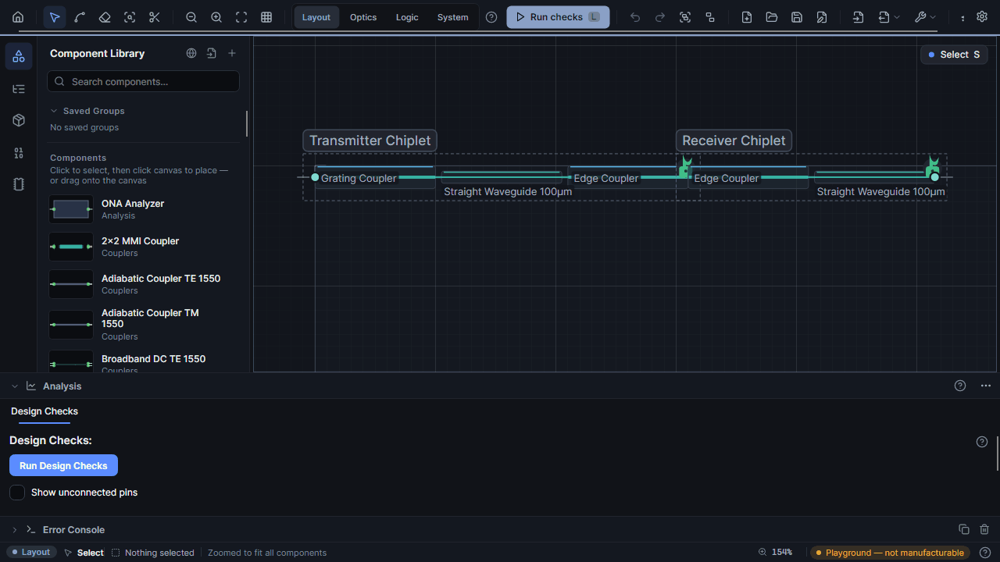
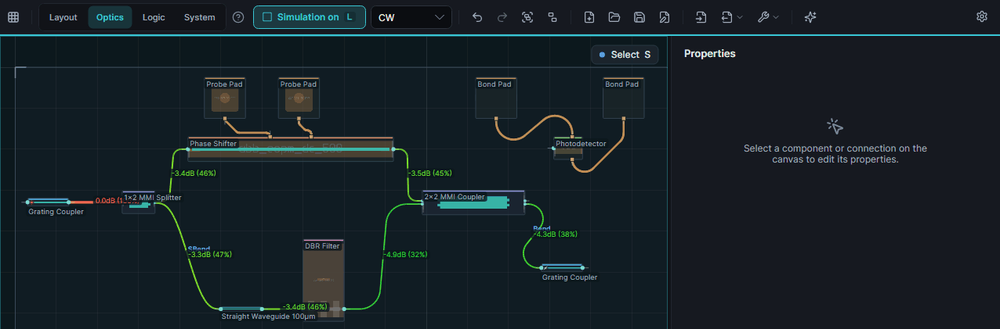
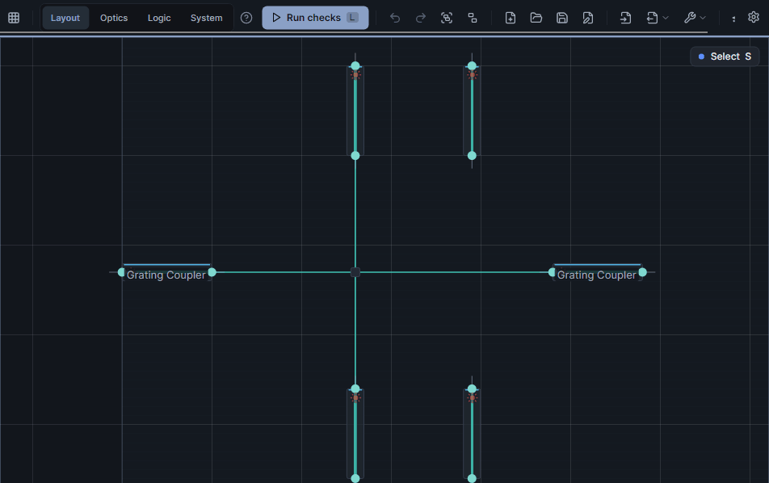
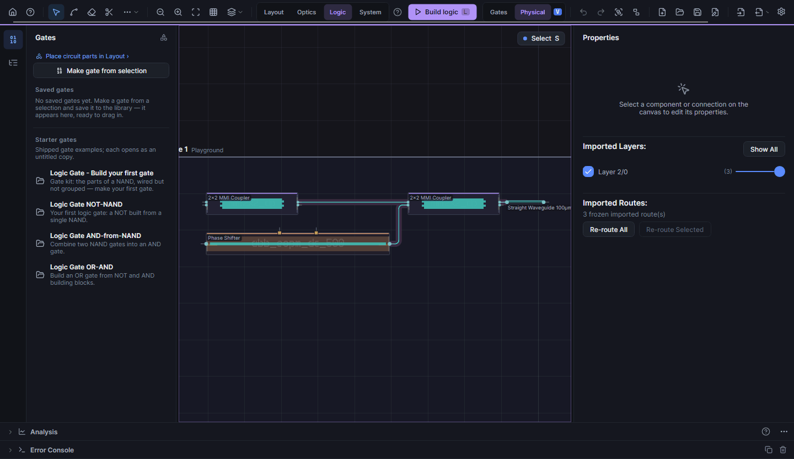
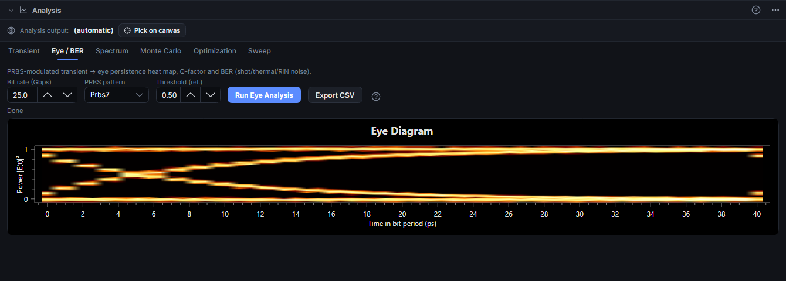
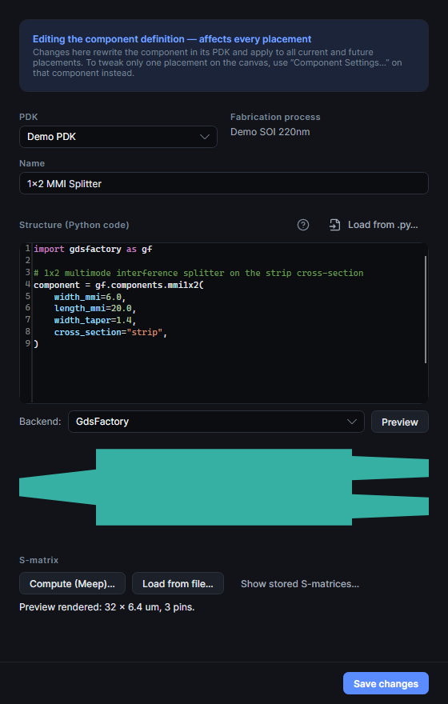
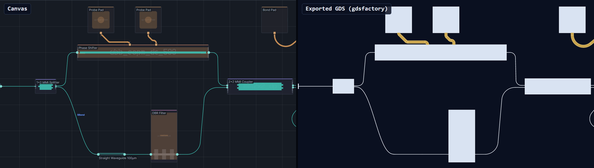
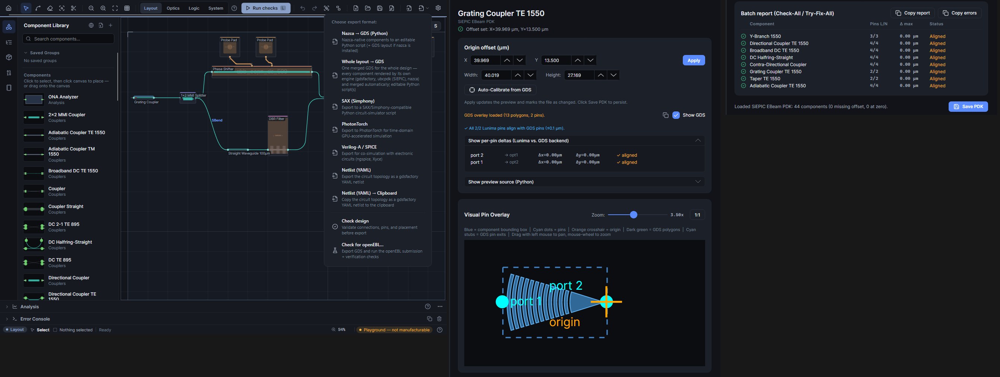

<h1>
  <picture>
    <source media="(prefers-color-scheme: dark)" srcset="docs/media/brand/lunima-wordmark-dark.svg">
    
  </picture>
</h1>

**Design, simulate, and lay out photonic integrated circuits — visually, on your own PDK, with open formats at every step.**


*A chip building itself: parts placed, the production router wiring connection after connection, DC metal traces to the pads — then **Run** in the Optics workspace lights up the simulated power flow on every waveguide.*

[](https://github.com/aignermax/Lunima/releases/latest) · [Landing page](https://aignermax.github.io/Lunima/) · [Changelog](CHANGELOG.md) · [Architecture](ARCHITECTURE.md)

---

## Workspaces

Layout, Optics, Logic and System look at the same design — each with its own accent colour, its own **Run** button (check, simulate, build logic, link chiplets) and the left panel and analysis tabs that fit the job.



## Live simulation

Switch the simulation on once — every edit after that re-runs it in the background. Connect a wire and it lights up; turn a phase shifter and watch the light move between the outputs.



## Crossings that stay out of your way

Cut any wire — even one coming out of a crossing — and a real PDK crossing drops in. Slide a crossing along its wire and only the two perpendicular pieces re-route.



## Make a logic gate

Select a few photonic parts and press **Make gate**: Lunima groups them, simulates every input combination and proposes the threshold that turns optical power into a truth table.



<!--CHIPLETS-->
<!--AGENT-->

---

## More of what's inside

**Simulate & measure.** Transient analysis (IFFT of the circuit S-parameters with pulse, CW or PRBS sources), eye diagrams with Q-factor and BER, wavelength sweeps, Monte-Carlo, FDTD with Meep in Docker, and measured S-matrices loaded back onto the components you drew.



**Your PDK, your components.** Define components in **gdsfactory or nazca** Python, preview the geometry and compute the S-matrix with Meep — all in one editor. Editing a bundled component forks it into your own PDK; deleted PDKs go to a trash you can restore from. Each PDK carries its fabrication process (layer stack, cross-sections, bend radii the router enforces, your own refractive indices).



**From canvas to fab.** Bundled [CornerStone](https://www.cornerstone.sotonfab.co.uk/) SiN 300 nm and [SiEPIC EBeam](https://github.com/SiEPIC/SiEPIC_EBeam_PDK) SOI 220 nm PDKs, pin-calibrated against their real GDS cells. One design, one process — free mixing lives in a Playground the status bar labels *not manufacturable*. Export GDS through gdsfactory or nazca, plus SAX, PhotonTorch, Verilog-A and gdsfactory YAML netlists.



*Left: the canvas. Right: the real exported GDS — the generated gdsfactory script was executed and `design.gds` rendered back at the same scale and position.*



**Open by design.** Open JSON PDKs ([format](docs/PDK_JSON_FORMAT.md)), netlists you can feed to SAX, routing you can style, freeze or replace per connection, and a UI in five languages (English, Deutsch, Español, 简体中文, 日本語).

---

## Download

Get the **[latest Lunima release](https://github.com/aignermax/Lunima/releases/latest)** — or browse [all releases](https://github.com/aignermax/Lunima/releases).

| Platform | Package | Notes |
|----------|---------|-------|
| **Windows** (x64) | [`Lunima-Setup-<version>.msi`](https://github.com/aignermax/Lunima/releases/latest) · [portable `.zip`](https://github.com/aignermax/Lunima/releases/latest) | Installer or unzip-and-run |
| **Linux** (x64) | [`Lunima-<version>-linux-x64.tar.gz`](https://github.com/aignermax/Lunima/releases/latest) | Extract into its own folder and run |
| **macOS** (Apple Silicon / Intel) | [`Lunima-<version>-osx-arm64.dmg`](https://github.com/aignermax/Lunima/releases/latest) · [`Lunima-<version>-osx-x64.dmg`](https://github.com/aignermax/Lunima/releases/latest) | Unsigned — see note below |

macOS release builds ship as an **unsigned** `.dmg`; on first launch, remove the quarantine flag with `xattr -dr com.apple.quarantine /Applications/Lunima.app`.

Once installed, Lunima **updates itself in place** (download, swap, relaunch) on all three platforms; if the install location isn't writable, it points you to the releases page instead.

### Building from source

**Prerequisites:** .NET 10.0 SDK

```bash
# Quick start
make run      # or ./run.sh

# Build and test
dotnet build
dotnet test
```

---

## Vision: Photonic Intermediate Representation (PIR)

### The Central Idea

👉 **Lunima is becoming the central representation layer for photonic systems**

- **Today:** GUI-based design tool
- **Tomorrow:** Central PIR with multiple views and exports
- **Future:** Integration hub for PhotonTorch, PICWave, Verilog-A, LTSpice

### PIR = `.lun` File Format

The `.lun` file format is evolving to become the PIR — a tool-independent representation that:

- Defines components and connections as a **netlist / graph**
- Accumulates physical, structural, and simulation data over time
- Enables **export to and import from** different simulation tools
- Evolves from schematic → device simulation → circuit simulation → system co-simulation

**This means:**
- GUI is just one view of the PIR
- Export is just a transformation of the PIR
- AI becomes extremely powerful with structured access to PIR

### Role in the Photonics Toolchain

| Layer | Tools | Purpose |
|-------|-------|---------|
| **Device-level simulation** | Tidy3D, FimmProp, Lumerical MODE | EM simulation, S-matrix extraction |
| **Circuit-level simulation** | PICWave, PhotonTorch | System behavior using S-matrices |
| **System / Digital Twin** | Verilog-A, LTSpice, Xyce | Photonic + electronic co-simulation |

**Lunima's position:** Between schematic design and system-level simulation.

Lunima acts as a **design and integration layer**, allowing information to flow between tools rather than duplicating their functionality.

---

## Documentation

- **[Architecture Guide](ARCHITECTURE.md)** — Code structure, DI, routing, S-matrix simulation
- **[Changelog](CHANGELOG.md)** — Completed features and milestones
- **[PDK JSON Format](docs/PDK_JSON_FORMAT.md)** — The open component-library format
- **[Agent Development Guide](CLAUDE.md)** — For AI-assisted development
- User Guide *(coming soon)*

---

## Roadmap

### 🎯 High Priority: PIR Evolution

- [ ] **Expand `.lun` format** — Add S-matrix storage, simulation metadata, external tool links
- [ ] **Import S-parameters from Lumerical/Tidy3D** — Direct device simulation integration
- [ ] **Export to PhotonTorch** — Circuit-level time-domain simulation
- [ ] **Export to Verilog-A** — System-level co-simulation

### 🎯 High Priority: Professional Features

- [ ] **Connection validation** — Warn about pin angle mismatches, unconnected pins
- [ ] **Design Rule Checking** — Min bend radius, spacing violations
- [ ] **Wavelength sweep / spectral response** — Plot transmission vs wavelength
- [ ] **Parameterized models** — Components with interpolated S-matrices
- [ ] **Direct GDS export** — Without Nazca intermediate step

### 🎯 High Priority: PDK Expansion

- [ ] **Expand SiEPIC PDK** — Add remaining 31 components (43 total)
- [ ] **SiEPIC SiN PDK** — Silicon nitride platform support

### 🔮 Future Vision: Tool Integration

- [ ] **Browser version** — WebAssembly deployment
- [ ] **Python PDK extractor** — Convert Nazca PDKs to JSON
- [ ] **Component properties panel** — Edit S-matrix parameters per instance

### 🔮 Future Vision: Optical Computing

- [ ] **Nonlinear components** — S-matrix depends on input power
- [ ] **Delay lines** — Waveguide loops with propagation time
- [ ] **Pulsed laser source** — Time-domain clock for optical logic
- [ ] **Multi-chip interconnect** — Inter-chip optical cables

See [CHANGELOG.md](CHANGELOG.md) for completed features.

---

## Contributing

We welcome contributions! Please see:

- [CONTRIBUTING.md](CONTRIBUTING.md) for the branch/PR workflow and conventions
- [CLAUDE.md](CLAUDE.md) for agent development guidelines
- [ARCHITECTURE.md](ARCHITECTURE.md) for technical details

For AI-assisted development, use the provided Python tools:

```bash
python3 tools/smart_test.py              # Compact test output
python3 tools/semantic_search.py "query" # Semantic code search
```

---

## Project status

Lunima is an independent MIT-licensed open-source project. It is not an official Akhetonics product.

Akhetonics supports the project through limited work-time contributions, as part of its broader interest in open photonic design tooling. The project remains independently maintained and community-driven.

Supported by [](https://www.akhetonics.com/)


---

## Origins

Lunima originated from [Connect-A-PIC](https://github.com/Akhetonics/Connect-A-PIC) and has evolved into a standalone photonic design system.

---

## License

MIT License - see [LICENSE](LICENSE) for details.
