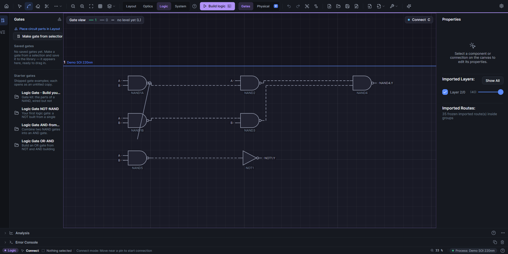

# Gate connections

Actual headless MainWindow render of the shipped Half Adder. C keeps the Logic gate view active; the preview starts at NAND1A's displayed output terminal and follows the pointer into empty canvas. Releasing there cancels without removing the existing connection.

Generated by `GateSymbolConnectionTests.CancelledWire_LeavesConnectionsIntact_ThenGateCanStillBeDragged`.
