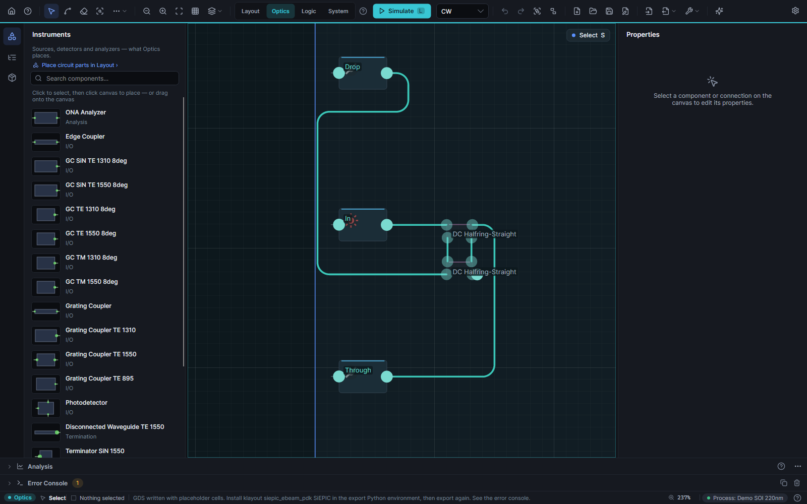

# Export warning verification

Windows x64, 2026-11-16, Release publish of the issue branch (version 0.23.0).
The published bundle was copied outside the checkout with isolated preferences.
Both runs loaded its shipped `EBeam Add-Drop Ring.lun` through `agent call export_gds`.

| Python environment | Result |
| --- | --- |
| Nazca 0.6.1, no klayout/SiEPIC | 8,778-byte GDS, three warnings, explicit warning status |
| Nazca 0.6.1 with klayout, siepic_ebeam_pdk, SiEPIC | 138,434-byte GDS, real coupler hierarchy, all six waveguides carry 1/99, no warnings |

[Captured JSON and cell inspection](packaged-export.json) records both outcomes.
The inspector uses the full Python environment to read both GDS artifacts; it does
not run the export in that environment for the placeholder case.

Reproduce with:

```text
python scripts/verify_gds_export_warnings.py <published-executable> <nazca-only-python> <siepic-python>
```

The existing status bar displays the localized corrective action, while the error
console retains the original script diagnostics. This screenshot comes from the
headless desktop workflow regression with a controlled export result; the separate
packaged journey above verifies actual Python execution and GDS geometry.



Capture again by setting `UI_SHOT_DIR` to this directory and running
`python scripts/run_tests.py GdsExportWarningJourneyTests`.
The corrective action is provided in English, German, Spanish, Japanese and Chinese.
No new UI surface was introduced.

Verification was repeated against the existing Windows publish: both packaged
journeys and geometry assertions passed. The desktop build completed with zero
warnings/errors; 42 focused export and warning tests passed without skips using
`scripts/run_tests.py`. Coverage includes exit zero without a GDS artifact, which
remains a failure while retaining script warnings. The test project still emits
pre-existing warnings outside the changed tests. The source-size guard passed.

Independent customer acceptance is unavailable. macOS/Linux and MSI installation
were not exercised locally; the Windows published executable was exercised directly.
