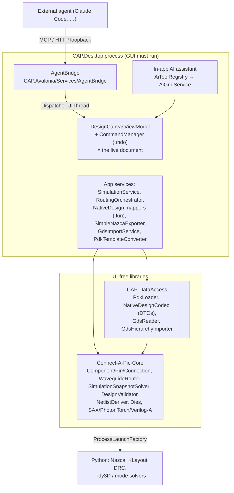

# Agent-First Architecture & Product Strategy Review

*Status: research note, 2026-11-01. No production code was changed for this review.*

Every claim is tagged:

- **[F] verified fact.** Read in the repository at the cited path, or found in a cited external source.
- **[A] technical assessment.** An engineering judgement derived from the facts.
- **[H] strategic hypothesis.** A product bet that needs user evidence before it is believed.

---

## 1. Executive summary

- **[F]** Lunima already has a working agent interface. The agent bridge is an MCP server (Streamable HTTP on `127.0.0.1:39271`) with about 30 tools and 52 test files. It lives *inside the running desktop app* and edits the open document through the UI's own undo history. See `docs/AGENT_BRIDGE.md` and `CAP.Avalonia/Services/AgentBridge/`.
- **[F]** The physics and geometry engines are UI-free and live in `Connect-A-Pic-Core`, with no Avalonia reference. That covers the S-matrix solver, router, validators, netlist derivation, chiplet model, and GDS reading in DataAccess.
- **[F]** The *document* is not UI-free. The live design is `DesignCanvasViewModel`, a collection of `ComponentViewModel` and `WaveguideConnectionViewModel` objects. Several operations depend on it:
  - `.lun` save and load
  - placing a PDK component
  - Nazca/GDS export
  - applying a GDS import
  - simulation input assembly
  - routing orchestration

  **The proposed architecture's "Lunima Core" box therefore does not exist yet as a document-level API.**
- **[A]** The agent surface is stronger at *diagnosing and repairing* an existing layout than at *creating, parameterising, simulating and exporting* one. These tools are missing or weak:
  - structured simulation results
  - component parameters
  - DRC
  - export
  - GDS import
  - opening arbitrary files
- **[A]** A headless core with a CLI would mean extracting a document aggregate out of `DesignCanvasViewModel` and porting about 10 persistence mappers, plus the export and orchestration code. That is a multi-week refactor with real regression risk. It is not justified before the hypothesis is tested.
- **[H]** "Agent-friendly PIC design" is not a differentiator on its own. GDSFactory+ already ships an MCP server, and Flexcompute and academic groups publish agentic photonic-design loops. Lunima's plausible edge is the combination: a local, open, visual environment where an agent's work can be *watched, inspected and undone*, plus circuit/chiplet simulation and many export targets. This is unvalidated.
- **Recommendation:**
  - Stay **hybrid (B)** and treat the agent surface as a first-class *client of the GUI document*. Do not add a headless layer yet.
  - Close the 3–4 smallest gaps that block an end-to-end loop (Section 9).
  - Run one bounded experiment with real tasks.
  - Decide on any headless or core extraction only from its results.

---

## 2. Current architecture

### 2.1 Projects and references [F]

| Project | References | Role |
|---|---|---|
| `CAP_Contracts` | – | Shared contracts |
| `Connect-A-Pic-Core` (`CAP-Core.csproj`) | Contracts; MathNet.Numerics, NCalcSync, YamlDotNet | Domain model, routing, solvers, analysis, exporters |
| `CAP-DataAccess` | Core, Contracts | PDK JSON loader, `.lun` DTOs and codec, GDS reader, PIR data |
| `CAP.Avalonia` | Core, DataAccess; Avalonia, CommunityToolkit.Mvvm, MS DI | ViewModels, views, app services, **agent bridge**, **AI assistant** |
| `CAP.Desktop` / `CAP.Browser` | CAP.Avalonia | Platform hosts |
| `Tools/Lunima.ArchitectureAnalyzers` | Roslyn | Layering and boundary analyzers |
| `UnitTests` | all of the above, Avalonia.Headless.XUnit | Tests, headless UI screenshots |

### 2.2 Where the seams actually are [F]

| Capability | UI-free part | UI-coupled part |
|---|---|---|
| Domain model | `Components/Core/Component.cs`, `PhysicalPin`, `ComponentGroup`, `WaveguideConnection`, `WaveguideConnectionManager.AddConnection` | The live lists are VM collections in `DesignCanvasViewModel` |
| PDK placement | `CAP-DataAccess/.../PdkLoader.cs`, `BundledPdkCatalog` | `PdkTemplateConverter.ConvertToTemplate` → `ComponentTemplate : ObservableObject` (`ViewModels/Library/ComponentTemplates.cs`) → `CreateFromTemplate` |
| Parameters | `Component.Sliders.cs`, `ParametricSMatrix.SetParameterValue` | Laser wavelength and power in `LaserConfig : ObservableObject` |
| Routing | `Routing/WaveguideRouter*`, `WaveguideConnectionManager.RecalculateAllTransmissionsAsync`, `UnroutableWireMemory` | `ViewModels/Canvas/Services/RoutingOrchestrator.cs` (cancellation, A* grid init, `Dispatcher.UIThread.Post`) |
| Simulation | `SimulationSnapshotCapture.Capture` → `SimulationSnapshotSolver.RunAsync`; `TimeDomainSimulator`; `ParameterSweeper` | `Services/SimulationService.RunAsync(DesignCanvasViewModel, …)`; `TransientCircuitFactory` (internal, takes the VM) |
| `.lun` persistence | `NativeDesignCodec`, `DesignFileData` DTOs | `NativeDesignCapture` (ctor takes the VM), `NativeComponentMapper`, `NativeConnectionLoader`, `NativeGroupLoader`, `NativeDesignPostLoad` under `ViewModels/Panels/NativeDesign/` |
| GDS export | `Export/GdsExportService.ExportToGdsAsync(scriptPath)` (runs Python) | `Services/SimpleNazcaExporter.Export(DesignCanvasViewModel, …)` writes the script |
| GDS import | `Import/Gds/GdsReader`, `GdsHierarchyImporter` (native C#) | `Services/GdsImport/GdsImportService`, `GdsPlacementExecutor` (holds the canvas VM) |
| Validation | `Analysis/DesignValidator.Validate(…)`, `PerConnectionDrcChecker`, spacing and overlap detectors, `DieAssemblyChecker` | `DesignValidationViewModel` only |
| Netlist / interop | `Export/Netlist/NetlistDeriver.Derive(components, connections)`, `GdsFactoryYamlNetlistWriter`, `SaxExporter`, `PhotonTorchExporter`, `VerilogAExporter` | callers pass the VM's components |
| Chiplets | `Components/Dies/*`, `ChipletInterfaceChecker`, `ChipletEdgeCouplerCoupling` | `DesignCanvasViewModel.Dies.cs`, `NazcaDieAssemblyWriter` |

**[A] Pattern.** The algorithms are cleanly separated, but the composition root of a "design" is the canvas ViewModel. Core engines can be called with lists of `Component` and `WaveguideConnection`, but nothing in Core owns, loads or saves a complete design.

**[F] External usability.**
- About 504 of Core's classes are public.
- There is no NuGet packaging, no `GenerateDocumentationFile`, and no versioned API surface.
- The only command-line arguments are `--register-claude-code` and `--unregister-claude-code` (`CAP.Desktop/.../AgentBridgeCommandLine.cs`).

---

## 3. Existing MCP and agent capabilities

### 3.1 Mechanics [F]

- **Transport.** `McpHttpServer` is a `TcpListener` on loopback. `LoopbackRequestGuard` rejects a non-loopback Host or Origin. An optional bearer token is off by default. The server speaks MCP 2025-06-18, 2025-03-26 and 2024-11-05.
- **Execution.** `AgentToolCatalog` serialises tool calls (`SemaphoreSlim(1,1)`). Every call is marshalled to the UI thread (`Hosting/IUiDispatcher.cs`).
- **Edits.** Edits go through `AgentDocumentOperation`, which uses revision stamps and refuses to act if the document changed underneath it.
- **Results.** Results are snake_case JSON (`AgentToolResult.Json`); `screenshot` returns a PNG.
- **Shared tools.** The catalog also exposes every in-app assistant tool (`AiToolRegistry`, through `AiToolAdapter`). The in-app assistant itself calls the Anthropic API (`Services/AiService.cs`).
- **Registration.** One-click Claude Code registration is in `Registration/ClaudeCodeRegistrar.cs`. The Windows MSI includes an option for it.

### 3.2 Capability matrix

| Capability | Status | Evidence and limits |
|---|---|---|
| Create / modify a circuit | **Partial** | `place_component`, `create_connection`, `move_component`, `delete_*`, `create_group`, `ungroup`. There is no "new design" except `clear_grid`, which is not undoable. |
| Place and connect components | **Partial** | `AiGridService.PlaceComponentAsync` accepts `rotation` but never uses it (verified, `AiGridService.cs:115`). `create_connection` picks pins automatically (`FindBestPin`), so the agent cannot choose them. The assistant tools call `Execute()` directly instead of going through `CommandManager`, so they are probably not undoable. |
| Configure parameters | **Not available** | No tool touches sliders, `LaserConfig` or sweep settings. |
| Routing | **Partial** | `reroute_connections`, `shift_segment`, `insert_crossing`, `move_crossing_along_axis`, `suggest_fixes` and `apply_suggestion` are good for repair. There are no waypoints or explicit route styles. |
| GDS import | **Not available** | `GdsImportService` exists but is not exposed. |
| GDS / Nazca export | **Not available** | `SimpleNazcaExporter`, `GdsFactoryExport`, SAX and netlist exporters exist but are not exposed. |
| Run simulation | **Partial** | `run_simulation` returns only the text "Simulation completed…". |
| Results as structured data | **Weak** | `get_light_values` returns per-wire `loss_db` and `length_um`. `SimulationResult` (`Services/SimulationService.cs:408`) already holds `FieldResults`, `SystemMatrix` and `WavelengthsUsed`, but none of them are exposed. |
| Validate topology / physics | **Partial** | `list_connections` gives `blocked`, `failure_reason`, and the loss breakdown, which is strong. `move_component` refuses overlaps. `DesignValidator` and DRC checkers are not exposed. |
| Save / reload projects | **Partial** | `save_design` writes to any path. `load_example` opens shipped examples only, so arbitrary `.lun` files cannot be opened. |
| Multi-chip / chiplet | **Available (basic)** | `list_dies`, `create_die`, `set_die_process`, `move_die`, `link_dies`. There is no delete-die tool, and link loss is reported at 1550 nm only. |
| Visual verification | **Available** | `screenshot` of the whole design or a µm region. |

### 3.3 Delegation vs duplication [F/A]

- **[F] Delegation.** Edit tools wrap the same undoable commands as the UI (`MoveComponentCommand`, `InsertManualCrossingCommand`, `SegmentShiftCommand`). Loss data is Core's `ConnectionLossBreakdown`, rounded only for output.
- **[F] Bridge-owned logic.** The repair heuristics live only in the bridge (`Repair/Suggest/RepairCandidateGenerator*`): fixed ±10/±20 µm steps and a ranking. `AiGridService` has its own pin-picking and centring logic.
- **[A]** This repair logic is product logic placed in the transport layer. It is acceptable while the bridge is the only consumer.
- **[F] Doc drift.** `docs/AGENT_BRIDGE.md` says suggestion trials run "on the open design". The code (`RepairWorkbench.CreateAsync`) runs them on a separate canvas VM built from a routing snapshot.

### 3.4 Fitness for autonomous agents [A]

- **Deterministic:** mostly. The tool order is sorted and the edits are revision-guarded. Repair ranking depends on time budgets.
- **Observable:** good for routing state, weak for optics.
- **Safe:** loopback only, undoable bridge edits, an overwrite guard on save. Weak spots:
  - `clear_grid` cannot be undone.
  - The assistant tools bypass undo.
  - Assistant-tool failures come back as plain text, not `isError`, so an agent can mistake a failure for success.
- **Testable:** 52 bridge test files, including HTTP integration tests (`UnitTests/AgentBridge/`).

### 3.5 Other agent assets [F]

- Repository skills: `.claude/skills/process-issue`, `check-issues` and `gds-export-debugging`. These serve *development* of Lunima, not *use* of it.
- `mcp-servers/openviking` is an unrelated code-search helper.

---

## 4. Headless operation readiness

| Question | Answer |
|---|---|
| Can agents work without a running desktop app? | **No [F].** Every tool needs the GUI process and UI thread. |
| Can Core alone build, route, simulate and validate a design? | **Engines yes, workflow no [F].** Core can do it from in-memory `Component` and `WaveguideConnection` lists. It cannot load a `.lun` file, instantiate a PDK component, or write Nazca without CAP.Avalonia. |
| Is there an existing near-headless path? | **[F]** The tests host the real ViewModels under `Avalonia.Headless.XUnit` (for example `UnitTests/Persistence/ConnectionsRoundTripTests.cs`). **[A]** The same VM graph could be hosted in a headless process, such as a `--mcp-stdio` mode of `CAP.Desktop`, with no domain refactor. It would be a pragmatic but inelegant route to a GUI-less agent server. |
| What would a "real" headless core require? | **[A]** Move PDK template creation, a document aggregate replacing `DesignCanvasViewModel` as the owner, the NativeDesign mappers, `SimpleNazcaExporter` and its writers, `TransientCircuitFactory`, and a dispatcher-free routing orchestrator into Core/DataAccess. Each is reasonable alone; together they are weeks of work and touch the most regression-sensitive code (save/load, export). |

**[A] Does headless matter yet?** For the hypothesis "an agent can do useful photonic engineering with Lunima", no. A visible window is a *feature* while trust is low: the user watches the agent and presses Ctrl+Z. Headless matters for CI pipelines, batch sweeps and server use, and none of those users has been identified yet.

---

## 5. Code-first vs visual-first vs agent-first

**What already exists for programmatic creation [F]:**

- `.lun` is documented JSON (`DesignFileData`). Example designs are generated by scripts that write it directly. For example, `scripts/generate_ram_2x2.py` writes 37 groups and 47 wires, with uniqueness assertions.
- **[A]** This is de facto code-first authoring through the file format, and an agent already used it to build examples. The limits: no validation or routing until the file is opened in the GUI, and the script must know PDK geometry by heart.
- Lunima exports a gdsfactory-style YAML netlist (`GdsFactoryYamlNetlistWriter`), SAX, PhotonTorch, Verilog-A and Nazca. That is outbound interop; there is no matching inbound netlist import.

| Workflow | Strength | Weakness | Fits persona |
|---|---|---|---|
| Visual-first | Precise inspection, learnability, demo path | Slow for repetitive or parametric work; hard to diff | Peter (Figma precision), Jonas, Ingrid |
| Code-first (Python/DSL) | Parametric, reproducible, diffable | Lunima would compete with gdsfactory and Nazca on their home turf | Priya, Mirko (already have Python tools) |
| Agent-first | Natural-language intent → edits; repairs and analyses at scale | Needs structured observability and trust; output quality unproven | Mirko (scriptable), possibly Peter for chores |

**Assessments [A]:**

- **Python integration.** It is *convenient for interop*, which already exists through exporters and managed Python environments. It is not needed for agent use: agents can call MCP tools or write JSON.
- **Bidirectional sync with arbitrary Python code.** Not justified. It is a round-trip problem with no general solution, and no user has asked for it.
- **A new DSL.** No demonstrated problem that `.lun` JSON plus MCP tools cannot solve. Reject unless a user shows one.
- **The best-value representation** is the existing `.lun` format plus the structured JSON the bridge already returns. Documenting `.lun` as a contract (JSON schema, units) is cheaper than any new format.

---

## 6. Competitive positioning and uncertainty

*External facts below come from a short web search on 2026-11-01. Treat this comparison as **provisional**: it is not a hands-on evaluation.*

| Tool | Verified (source) | Relevance |
|---|---|---|
| gdsfactory | Python layout library; netlist extraction, SAX circuit simulation interface, LVS-style checks ([PyPI](https://pypi.org/project/gdsfactory/6.107.4)) | The reference code-first stack; huge PDK and community reach |
| GDSFactory+ | GUI on VS Code; schematic capture, simulation, DRC/LVS ([Tower brochure](https://tgs.towersemi.com/wp-content/uploads/2025/10/brochure-GDSFactory.pdf)); **MCP server `gfp-mcp`** for Claude Code / Desktop ([PyPI](https://pypi.org/project/gfp-mcp/)) | Directly occupies "agent-driven PIC design" |
| Nazca Design | Open-source Python layout framework, AGPL, foundry PDK support via BRIGHT Photonics ([source](https://github.com/nickersonm/nazca-design/blob/main/__init__.py)) | Lunima already exports to it |
| Flexcompute (Tidy3D / PhotonForge) | Announced agent-driven design loops and an MCP for Tidy3D ([news](https://hs.flexcompute.com/news/agentic-photonic-design)) | Agent loops at the device/FDTD level |
| Research | LLM agents for PIC design automation ([arXiv 2508.14123](https://arxiv.org/pdf/2508.14123)); autonomous agentic photonics ([arXiv 2606.00915](https://arxiv.org/pdf/2606.00915)) | The idea is mainstream, not novel |

| Differentiator | Status for Lunima |
|---|---|
| Open source and local-first | **Demonstrated [F]** (desktop app, loopback-only bridge). Shared with gdsfactory and Nazca, so not unique. |
| Agent-friendly manipulation | **Partially demonstrated [F]**, strong for repair. **Not unique [F]** (gfp-mcp). |
| Visual inspection of agent work, live, with undo | **Demonstrated [F]**. Whether users value it over a VS Code GDS viewer is **unvalidated [H]**. |
| Semantic reconstruction of GDS | **Partially demonstrated [F]**: hierarchy import, pin suggestions, frozen routes. Quality on foreign layouts is **unvalidated [H]**. |
| Circuit-level simulation in the same tool as layout | **Demonstrated [F]** (S-matrix, transient, sweeps). gdsfactory+SAX covers this in Python. |
| Multi-chiplet modelling | **Demonstrated at basic level [F]**: dies, processes, edge-coupler loss, per-die DRC and export. Possibly rarer among open tools, **unverified [H]**. |
| Cross-tool interoperability | **Outbound demonstrated [F]** (Nazca, gdsfactory YAML, SAX, PhotonTorch, Verilog-A). Inbound is GDS only. |
| Education ladder (NAND2TETRIS for photonics) | **Demonstrated [F]** (`docs/ROADMAP.md`, about 30 examples). Probably the most distinctive asset **[H]**. |

---

## 7. Strategic alternatives

The scores below are assessments **[A]**.

| | A. Visual CAD first | B. Hybrid | C. Agent first | D. Integration layer |
|---|---|---|---|---|
| Effort | Continuous UI polish; never "done" | Low incremental: thin bridge adapters | High if done properly (headless core, CLI, docs) | Medium–high: importers per tool and format churn |
| Readiness | High | High: bridge exists, gaps are adapters | Low: document lives in the VM | Medium: exporters exist, importers do not |
| User value | Proven for learners and demos; experts compare it with KLayout/Nazca | Plausible: agent does chores, human inspects | Unproven; depends on agent quality | Real for Priya/Mirko if it's reliable |
| Differentiation | Weak versus mature CAD; strong in education | Moderate: "watch the agent work" | Weak: gfp-mcp, Flexcompute are already there | Weak–moderate: gdsfactory is the hub others integrate with |
| Maintainability | UI code is the most expensive to keep | Good if tools stay thin wrappers | Two front-ends to keep in parity | Format drift in third-party tools |
| Fit for a part-time maintainer | OK | **Best** | Poor: a second product | Poor: endless adapter work |

**Opportunity costs:**

- **C:** freezes UX and education work for a refactor whose payoff is unproven.
- **D:** turns Lunima into glue code for tools that move faster than one maintainer can follow.
- **A:** ignores that the maintainer's own development already runs through agents. The MCP bridge exists precisely because that loop is useful.

---

## 8. Recommended direction

**B (hybrid), with agent access treated as a client of the GUI document.**

- **[A]** Keep the visual editor as the single source of truth. It is where a human inspects, explains (education) and corrects. The bridge already gives agents the same document with undo.
- **[A]** Expose **both** levels of operation:
  - Low-level edits, which already exist.
  - A few *verification* workflows that return structured results:
    - simulate and report port powers per wavelength
    - validate and report the issue list
    - export and report the artifact path plus any DRC summary
  - Do not build high-level "design me a ring filter" workflows. Agents compose those themselves, and reusable *skills* (Markdown, no backend) can capture recipes.
- **[A]** Agents should validate themselves through:
  - `list_connections` (blocked, loss)
  - a `validate_design` tool
  - structured simulation output
  - screenshots as a last resort
- **[A] Representation rules for new tools:**
  - Units belong in the field name (`_um`, `_db`, `_nm`), as the bridge already does.
  - Errors are `isError: true` with a reason code, never success-shaped text.
  - Warnings are a list with severity.
- **[A]** Do **not** build a CLI, a new abstraction layer, or a headless core now.
  - If the experiment shows that "the GUI must run" is the real blocker, the cheapest next step is to host the existing VM graph headlessly in one process mode, following the `Avalonia.Headless` precedent in the tests.
  - Extracting a Core document aggregate comes only after that, and only with a named consumer (CI, batch, a user).

---

## 9. One minimal validation experiment

**Question:** can an external coding agent take a circuit from intent to a validated, simulated, exportable result through Lunima, without anyone operating the GUI, faster and more reliably than doing it by hand?

**Setup:** Claude Code connected to the agent bridge. Lunima runs but is only watched, never touched.

**Tasks (five fixed prompts, three runs each):**

1. Open the Mach-Zehnder example; report the output power at both ports versus phase-shifter setting; identify the setting for full switching.
2. Build an MZI from an empty design using the demo PDK; it must match example 1's simulated response.
3. Open `Logic Gate Full Adder.lun`; verify the truth table by simulation.
4. Take an example with blocked routes (break one deliberately); repair until zero blocked; keep total loss within X dB of the original.
5. Two-chiplet example: change one die's process, re-validate, report any interface or DRC issue.

**Reuse:** the bridge transport, all existing tools, `SimulationService`, `DesignValidator`, `ConnectionLossBreakdown`, the dies tools, and the examples.

**Smallest additions** (each a thin adapter, no Core changes; a few evenings in total):

1. `get_simulation_result`: per external port and wavelength, the power in dB and the complex amplitude, from the existing `SimulationResult`.
2. `set_component_parameter`: set a slider or laser value (`Component.Sliders`, `LaserConfig`), through an undoable command.
3. `validate_design`: return the `DesignValidator` issues as JSON.
4. Fix `place_component` to honour `rotation`, and let `create_connection` take explicit pin names.
5. Optional, needed only for task 2's export step: `open_design(path)` and an `export_nazca` tool wrapping `SimpleNazcaExporter`.

**Measures:**

- Task success rate (correct per a pre-written reference answer).
- Human interventions per task.
- Wall-clock time compared with the maintainer doing it manually.
- Tool-call errors per task.
- How often the agent needed `screenshot` to understand state.

**Supports the hypothesis:** at least 4 of 5 tasks succeed in at least 2 of 3 runs with zero interventions, and tasks 1, 3 and 4 are clearly faster than doing them by hand.

**Weakens or falsifies it:**

- Agents routinely need screenshots or GUI help to understand the design, which would mean the structured state is insufficient.
- Task 2 fails repeatedly, which would mean construction from scratch is not agent-viable and Lunima is a *repair and analysis* tool for agents at best.
- Results are correct but no faster than by hand.
- **Most important:** two or three real users (Section 10) do not care, whatever the technical outcome.

---

## 10. Open questions requiring real user feedback

1. Do the personas in `docs/PERSONAS.md` correspond to people who have actually used Lunima? Which would hand a task to an agent rather than do it themselves? Peter's "manual edits are sacred" suggests resistance.
2. For gdsfactory users (Priya), is an agent driving *Lunima* more useful than an agent driving gdsfactory/GDSFactory+ directly? What would make them leave VS Code for it?
3. Would anyone run Lunima headless (CI, batch sweeps, servers)? If nobody can be named, the headless refactor stays off the table.
4. Is the visible, undoable, watch-the-agent workflow valued, or tolerated?
5. Is the education ladder the product, with agents as a tutor that builds and explains circuits? Or is it professional design? The answer changes what "agent-first" should mean.
6. Which inbound format matters most: gdsfactory netlist/YAML, Nazca, or GDS? Only build the one a user brings.
7. How mature is `gfp-mcp` in practice? A hands-on comparison is needed before claiming any agent-related advantage.

---

## Addendum (same day): what was built and what the experiment showed

The maintainer chose to go further than recommendation 8 and make the agent path fully
headless. It was done without the Core extraction this review warned about. The production
container, view-models included, now runs on Avalonia's headless platform
(`HeadlessAgentSession`). That was the cheap route Section 4 identified.

- **Interfaces [F].**
  - `CAP.Desktop mcp` is a stdio MCP server.
  - `CAP.Desktop agent tools|call|run|install` is a JSON command line.
  - A Claude Code plugin with workflow skills (`claude-plugin/lunima`) is included.
  - 73 tools in total, all on the desktop bridge's catalog, so the GUI and headless behave identically.
- **Gaps from Section 3.2, closed [F]:**
  - authoring: `place_component` with rotation and port-relative `attach_to`, `create_connection` with named pins, `connect_bundle`, `apply_design` (Lunima JSON and gdsfactory YAML)
  - parameters and light sources
  - structured `simulate`, `sweep_parameter`, `sweep_spectrum`, `optimize`
  - `validate_design` and `check_foundry_drc` (KLayout)
  - `compare_netlist` (LVS-style)
  - `export_gds`, `export_netlist`, `analyze_gds` / `import_gds`
  - floorplanning
  - logic gates, networks, registers and `isa_run` on the photonic units
- **Experiment task 2 [F]** (build an MZI from nothing, route, simulate, sweep, validate, save): a real Claude Sonnet agent with only the stdio server completed it in 23 tool turns, 31 s and $0.23. All routes were clean; it reported 55.8 dB extinction and switching at 90° and 270°.
- **Bugs found on the way [F]:**
  - SAX and Verilog-A export failed for every parametric component.
  - Selecting inside a document commit crashed the selection panels.
  - The assistant ignored rotation.
  - Connection GUIDs are not stable across loads; tools now accept `component.pin`.
- **Competitive note [F]** ([gfp-mcp on PyPI](https://pypi.org/project/gfp-mcp/)):
  - GDSFactory+'s MCP server exposes about 11 tools (build cells, DRC, connectivity, LVS, SAX simulation) and no editing or routing.
  - The gdsfactory-library features it relies on (YAML designs, `connect`, `route_bundle`, length matching, `add_fiber_array`) now have Lunima counterparts.

The open questions in Section 10 are unchanged. They need real users, not more tools.
